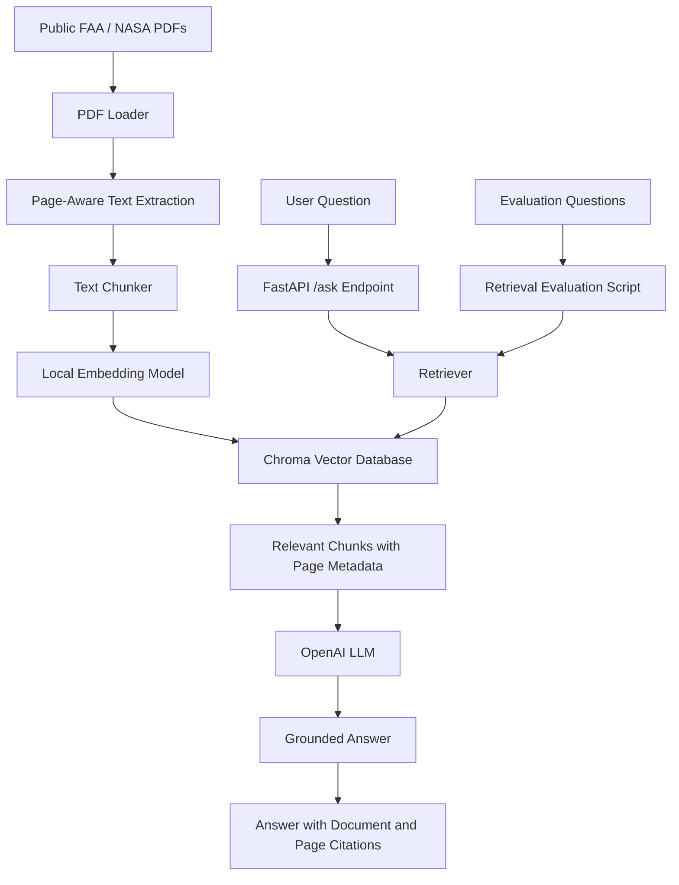

# Aerospace RAG Assistant

A Retrieval-Augmented Generation (RAG) question-answering assistant for aerospace and engineering technical documents, beginning with public FAA and NASA PDFs.

The assistant retrieves relevant passages from source documents, generates a grounded answer, and returns citations containing the document name and page number.

## Current progress

- [x] Python project structure and virtual environment
- [x] FastAPI health endpoint
- [x] Pytest setup
- [x] Page-aware PDF text extraction with PyMuPDF
- [ ] Chunking and vector storage
- [ ] Retrieval and grounded LLM answers
- [ ] `/ask` API endpoint
- [ ] Streamlit user interface
- [ ] Retrieval evaluation
- [ ] Docker and GitHub Actions CI

## Architecture



## Technology choices

| Area | Tool | Reason |
|---|---|---|
| Backend API | FastAPI | Typed, fast, and provides automatic API documentation |
| PDF extraction | PyMuPDF | Extracts text page by page for accurate citations |
| Embeddings | Sentence Transformers | Free local semantic embeddings |
| Vector database | Chroma | Simple persistent vector storage with metadata |
| LLM | OpenAI Responses API | Generates grounded natural-language answers |
| UI | Streamlit | Quick interface for asking questions and viewing sources |
| Tests | pytest | Standard Python testing framework |
| Configuration | Pydantic Settings and `.env` | Typed settings without committing secrets |

## Project structure

```text
rag-aerospace-assistant/
├── app/
│   ├── api/                 # FastAPI route definitions
│   ├── core/                # Settings and logging
│   ├── ingestion/           # PDF extraction and chunking
│   ├── models/              # Pydantic request/response models
│   ├── retrieval/           # Embeddings, vector store, retrieval
│   ├── services/            # Grounded LLM question-answering service
│   └── main.py              # FastAPI entry point
├── data/
│   ├── raw/                 # Source PDFs; ignored by Git
│   └── chroma/              # Local vector database; ignored by Git
├── evaluation/              # Retrieval benchmark questions and script
├── tests/                   # Automated tests
├── ui/                      # Streamlit interface
├── .env.example             # Safe configuration template
├── .gitignore
├── requirements.txt
└── README.md
```

## Setup

### 1. Clone the repository

```powershell
git clone https://github.com/AdhishDatir/rag-aerospace-assistant.git
cd rag-aerospace-assistant
```

### 2. Create and activate a virtual environment

```powershell
py -3.13 -m venv .venv
Set-ExecutionPolicy -Scope Process -ExecutionPolicy Bypass
.\.venv\Scripts\Activate.ps1
```

### 3. Install dependencies

```powershell
python -m pip install --upgrade pip
python -m pip install -r requirements.txt
```

### 4. Run tests

```powershell
python -m pytest
```

## Run the API

```powershell
fastapi dev app/main.py
```

Then visit:

```text
http://127.0.0.1:8000/health
```

Expected response:

```json
{"status":"ok"}
```

## Source document

The initial source document is the FAA Advisory Circular 43-204, *Visual Inspection for Aircraft*.

Download it into `data/raw`:

```powershell
Invoke-WebRequest `
  -Uri "https://www.faa.gov/documentLibrary/media/Advisory_Circular/43-204.pdf" `
  -OutFile ".\data\raw\faa_ac_43_204.pdf"
```

Inspect page-aware text extraction:

```powershell
python -m app.ingestion.inspect_pdf --pdf .\data\raw\faa_ac_43_204.pdf
```

## Security

Never commit API keys.

Copy `.env.example` to `.env` when the LLM integration is added:

```powershell
Copy-Item .env.example .env
```

Then add your key locally:

```env
OPENAI_API_KEY=your_key_here
```

The `.env` file is excluded from version control by `.gitignore`.

## Grounding policy

The assistant will use only the retrieved PDF passages as evidence. If the retrieved context does not support an answer, it will respond:

```text
not found in the documents
```

## Evaluation

The final project will include 20–30 known-answer questions. Retrieval performance will be measured as top-k recall:

```text
Retrieval accuracy = questions where the expected passage appears in top-k / total questions
```

## License

This project is intended for learning and portfolio use. Source documents remain subject to the terms of their original public publishers.