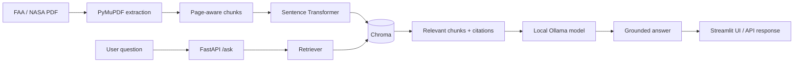

# Aerospace RAG Assistant

A local Retrieval-Augmented Generation (RAG) assistant for aerospace engineering documents. It indexes public FAA/NASA PDFs, retrieves relevant evidence, answers only from that evidence, and returns document/page citations.

## Features

- Page-aware PDF extraction with PyMuPDF
- Overlapping text chunks with document and page metadata
- Local Sentence Transformer embeddings stored in Chroma
- Semantic retrieval with top-k results
- Grounded local answers with Ollama and Qwen 2.5 3B
- Deterministic `not found in the documents` fallback for missing or weak evidence
- FastAPI `POST /ask` endpoint with latency/failure logging
- Streamlit browser UI
- 20-question labelled retrieval benchmark
- Pytest, Docker, and GitHub Actions CI

## Architecture



## Stack

| Area | Choice |
| --- | --- |
| API | FastAPI |
| Extraction | PyMuPDF |
| Embeddings | `sentence-transformers/all-MiniLM-L6-v2` |
| Vector database | Chroma |
| Answer model | Ollama with `qwen2.5:3b` |
| UI | Streamlit |
| Tests / CI | pytest / GitHub Actions |

## Setup

```powershell
git clone https://github.com/AdhishDatir/rag-aerospace-assistant.git
cd rag-aerospace-assistant
py -3.13 -m venv .venv
Set-ExecutionPolicy -Scope Process -ExecutionPolicy Bypass
.\.venv\Scripts\Activate.ps1
python -m pip install --upgrade pip
python -m pip install -r requirements.txt
```

Install [Ollama for Windows](https://ollama.com/download/windows), then download the local model:

```powershell
ollama pull qwen2.5:3b
```

Create `.env` from the safe template:

```powershell
Copy-Item .env.example .env
```

Default local configuration:

```env
OLLAMA_BASE_URL=http://localhost:11434
OLLAMA_MODEL=qwen2.5:3b
MAX_EVIDENCE_DISTANCE=0.75
```

No API key is required. `.env` is ignored by Git.

## Index a document

```powershell
Invoke-WebRequest `
  -Uri "https://www.faa.gov/documentLibrary/media/Advisory_Circular/43-204.pdf" `
  -OutFile ".\data\raw\faa_ac_43_204.pdf"

python -m app.ingestion.index_pdf --pdf .\data\raw\faa_ac_43_204.pdf
```

## Run

Start the API:

```powershell
fastapi dev app/main.py
```

Open `http://127.0.0.1:8000/docs` to try `POST /ask`, or call it directly:

```powershell
Invoke-RestMethod `
  -Method Post `
  -Uri "http://127.0.0.1:8000/ask" `
  -ContentType "application/json" `
  -Body '{"question":"What is the purpose of visual inspection for aircraft?","top_k":3}'
```

In another terminal, run the UI:

```powershell
streamlit run ui/streamlit_app.py
```

## Evaluation

Run the 20-question benchmark:

```powershell
python -m evaluation.evaluate_retrieval --top-k 4
```

A hit requires a top-k result from the expected document containing every manually labelled evidence term. The script reports the real top-k retrieval accuracy for the current index. Use that reported number—not an invented value—in a resume.

## Testing

```powershell
python -m pytest
```

The test suite has no API-key, Ollama, PDF-download, or prebuilt-index dependency.

## Docker

Build:

```powershell
docker build -t aerospace-rag-assistant .
```

Run with your local Chroma database and Ollama instance:

```powershell
docker run --rm -p 8000:8000 `
  -e OLLAMA_BASE_URL=http://host.docker.internal:11434 `
  -v "${PWD}\data\chroma:/app/data/chroma" `
  aerospace-rag-assistant
```

## Grounding policy

The model receives only retrieved excerpts. If no chunks are retrieved, the closest chunk is beyond the relevance threshold, or the model explicitly declines, the response is exactly:

```text
not found in the documents
```

Prompting alone cannot prove factuality, so the system combines the prompt with a deterministic distance cutoff, citations derived from retrieval metadata, tests, and retrieval evaluation.
